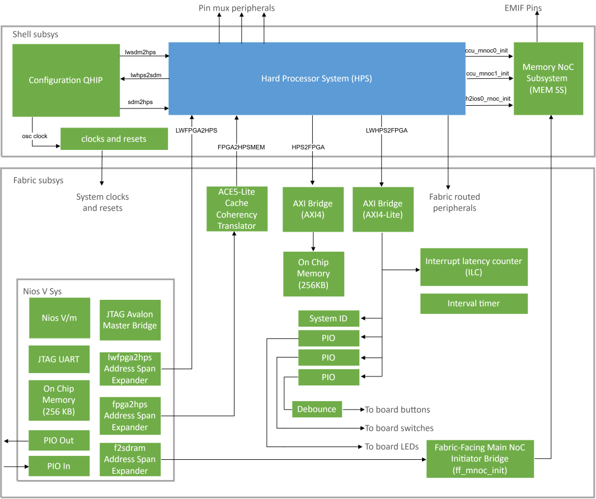

# HPS Baseline-A520 System Example Design with HPS Expansion Board for Agilex 27 Development Kit

HPS Baseline-A520 System Example Design for Agilex 27 Development Kit with Out of Box Experience (OOBE) daughter card, which is also known as HPS Enablement Expansion Board.

## Description

This design is a Baseline Hardware Reference Design for Altera Agilex 27 System On Chip (SoC) FPGA.

This design is part of the Baseline System Example Design, which provides a complete solution, including exercising soft IP in the fabric, booting to U-Boot, then Linux, and running sample Linux applications.

The design uses HPS First configuration mode and boots from Arm Cortex-A520 core 0 processor.

### Baseline-A520 feature

This design demonstrates the following system integration between Hard Processor System (HPS) and FPGA IPs:

- Hard Processor System (HPS) enablement and configuration
  - Enable dual core Arm Cortex-A520 processor
  - Enable dual core Arm Cortex-A720 processor
  - HPS Peripheral and I/O (SD/MMC, EMAC, MDIO, USB, I3C, JTAG, UART, and GPIO)
  - HPS Clock and Reset
  - HPS FPGA Bridge and Interrupt
- HPS EMIF configuration
- System integration with FPGA IPs
  - Fabric subsystem comprising the NiosV subsystem, 256 KB of FPGA on-chip memory, System ID, and Programmable I/O (PIO) IP that controls the DIP switches, push buttons, and LEDs.
  - NiosV subsystem comprising JTAG Avalon Master Bridge IP and Address Span Extender IP, which provide System Console debug access and FPGA content access through JTAG.

### USB modes

This design supports USB 3.1 in both host and device mode.
The USB mode is fixed at power-up and cannot be changed at runtime.

The mode is selected in the Linux device tree (DTS).
Set the `dr_mode` property as follows.

| dr_mode value | Equivalent USB mode |
|---------------|---------------------|
| host          | Host                |
| peripheral    | Device              |

## Project Details

- **Family**: Agilex 27
- **Quartus Version**: 26.3
- **Development Kit**: Agilex 27 Development Kit (OOBE / HPS Enablement Expansion Board)
- **Device Part**: A27_WHITEBOARD_PART
- **Category**: HPS
- **Source**: Quartus Prime Pro
- **URL**: https://github.com/altera-fpga/agilex27-ed-hps-baseline
- **Design Package**: dk-dev-agilex27-enablement-baseline-a520.zip
- **Documentations**: TBD

## Documentations

- **Title**: HPS Baseline System Example Design User Guide: Agilex 27 Development Kit
  **URL**: TBD


## Software projects

| Project | Description |
|---------|-------------|
| [Yocto Linux (SD)](software/yocto_linux/README.md) | Linux BSP build, boot, and Simics bring-up (SD) |
| [Yocto Linux (eMMC)](software/yocto_linux_emmc/README.md) | Linux BSP build for eMMC boot (demo only) |
| [Roll-your-own Linux](software/ryo_linux/README.md) | Minimal ATF/U-Boot/kernel SD boot image |

## Design overview


## Hard Processor System (HPS)
The HPS configurations in this design are provided for reference only and may change for production silicon and board bring-up.

## HPS External Memory Interfaces (EMIF) DDR
The HPS EMIF DDR configurations in this design are provided for reference only and may change for production silicon and board bring-up.

## Bridges
Bridges are used to transfer data between FPGA fabric and HPS logic.

| Bridge  | Use Case |
| :-- | :-- |
| F2SDRAM | Move data from FPGA fabric to EMIF (non-coherent). |
| FPGA2HPSMEM | Move data from FPGA fabric to HPS logic (coherent). |
| LWFPGA2HPS | Access HPS peripheral Control Status Register (CSR) from FPGA. |
| LWHPS2FPGA | Access FPGA peripheral Control Status Register (CSR) from HPS. |
| HPS2FPGA | Move data from HPS logic to FPGA fabric. Access FPGA Onchip Memory as scratch pad. |

In this design, fabric peripherals on the lightweight HPS-to-FPGA (LWHPS2FPGA) bridge use bridge base `0x0800_0000` plus the peripheral offset (see [Peripherals](#peripherals)).

### Notes for LWHPS2FPGA address offset
On Agilex 27, LWHPS2FPGA traffic is decoded by `hps_rnoc_init` before it reaches the fabric. The LWHPS2FPGA interface sits before that decoder, so simulation and HPS software see the same address map.

| Rule | Type | Window | Destination |
|------|------|--------|-------------|
| RULE0 | `RNOC_SDM` | 32 MB @ `0x0000_0000` | SDM / config (`r0s0`) |
| RULE1 | `RNOC_STACKED` | 16 MB @ `0x0800_0000` | FPGA fabric (`r1s0` → `lwhps2fpga`) |
| RULE2 | `RNOC_STACKED` | 16 MB @ `0x0D00_0000` | FPGA fabric (`r1s0` → `lwhps2fpga`) |

Fabric CSR targets in this design therefore reside at **`0x0800_0000` + peripheral offset**, for example sysid at `0x0801_0000`. Addresses in the `0x0000_0000` window are routed to the SDM rather than to the fabric.

### Notes for HPS2FPGA address offset
On Agilex 27, HPS2FPGA traffic is decoded by `hps_mnoc_init` before it reaches the fabric. Unlike the lightweight path, this initiator carries a single identity rule, so it does not relocate the address:

| Rule | Type | Window | Target offset | Destination |
|------|------|--------|---------------|-------------|
| RULE0 | `SINGLE_TARGET` | 256 GB @ `0x0000_0000` | `0x0` | FPGA fabric (`r0s0` → `fpga_mnoc_tgt` → `hps2fpga`) |

RULE1–RULE7 are disabled (`AT_RULE*_ENBL = "false"`), so no SDM or peripheral window competes with the fabric on this port. Because the window base and the target offset are both `0`, an address presented to `hps_mnoc_init` appears unchanged on the fabric-facing `hps2fpga` interface, truncated to 40 bits.

Fabric targets on this bridge therefore reside at the **fabric offset with no bridge base added**; the 256 KB FPGA on-chip memory is located at `0x0000_0000`. This behavior differs from LWHPS2FPGA, where `0x0000_0000` is the SDM window and fabric access requires the `0x0800_0000` base.

### Notes for HPS2FPGA (H2F) data width

The H2F path uses different data widths on the HPS-facing and fabric-facing sides:

| Side | Width | Notes |
|------|-------|--------|
| HPS / SoC (manager BFM) | 256-bit | Full beat = 32 bytes; narrow beat = 16 bytes (128-bit) |
| FPGA fabric bridge | 512-bit | Fabric-side `hps2fpga` data/strobe |

An internal NoC stage converts between 256-bit and 512-bit (`NARROW_PACKING_EN`). This conversion adds latency and represents an intentional tradeoff among power, timing, and fabric standardization rather than a defect.

For simulation, drive and check transfers at the **256-bit** HPS-facing width. Driving or checking 512-bit transfers from the manager BFM is not valid.

## Fabric Subsystem

### NiosV Subsystem

In the NiosV subsystem, the JTAG Avalon Master Bridge IP provides System Console access to the peripherals in the FPGA. This access does not depend on HPS software drivers.

| NiosV | Attribute | Address Offset | Size (bytes) |
|:------|-----------|----------------|:------------:|
| ocm | On-Chip Memory | 0x0 | 262144 |
| jtag_uart | JTAG UART | 0x0005_0040 | 8 |
| pio_in | PIO (Parallel I/O) Inputs | 0x0005_0050 | 16 |
| pio_out | PIO (Parallel I/O) Outputs | 0x0005_0060 | 16 |
| fpga2hps_address_span_extender | Address Span Extender | 0x0005_0070 (cntl)<br>0x4000_0000 (slave) | 8<br>1073741824 |
| f2sdram_address_span_extender | Address Span Extender | 0x0005_0080 (cntl)<br>0x8000_0000 (slave) | 8<br>1073741824 |
| lwfpga2hps_address_span_extender | Address Span Extender | 0x0005_0090 (cntl)<br>0xc000_0000 (slave) | 8<br>1073741824 |

### SDRAM Access via Address Span Extender (F2SDRAM / FPGA2HPS)

#### Overview

System Console and Nios V operate in a **32-bit address space** and cannot directly access full 64-bit SDRAM addresses. The Address Span Extender IP exposes a fixed **1 GB window** into the HPS/EMIF address map.

#### Address Span Extender IP

The **Address Span Extender IP** uses two control registers — **CSR_L** and **CSR_H** — to construct a full 64-bit physical address from a 32-bit windowed data address.

| Register | Base Address | Holds |
|----------|--------------|-------|
| `CSR_L` | `0x50070` (FPGA2HPS) | Bits `[31:0]` of 64-bit target address |
| `CSR_H` | `0x50074` (FPGA2HPS) | Bits `[63:32]` of 64-bit target address |
| `CSR_L` | `0x50080` (F2SDRAM) | Bits `[31:0]` of 64-bit target address |
| `CSR_H` | `0x50084` (F2SDRAM) | Bits `[63:32]` of 64-bit target address |
| `CSR_L` | `0x50090` (LWFPGA2HPS) | Bits `[31:0]` of 64-bit target address |
| `CSR_H` | `0x50094` (LWFPGA2HPS) | Bits `[63:32]` of 64-bit target address |

Together, **CSR_H** and **CSR_L** define the physical region targeted by the 32-bit windowed slave.

#### Sliding window

- The **window** is a fixed **1 GB** aperture (`0x0` to `0x4000_0000` in internal offset).
- Windowed slave bases in this design are as follows:
  - F2SDRAM: `0x8000_0000` – `0xBFFF_FFFF`
  - FPGA2HPS: `0x4000_0000` – `0x7FFF_FFFF`
  - LWFPGA2HPS: `0xC000_0000` – `0xFFFF_FFFF`
- Update `CSR_L` and `CSR_H` to move the window to the required physical SDRAM or HPS region for the board EMIF map.


### Peripherals

| Peripheral | Address Offset | Size (bytes) | Attribute | Interrupt Number |
| :-- | :-- | :-- | :-- | :-- |
| interval_timer | 0x0000_0000 | 32 | Interval timer | 1 |
| interrupt_latency_counter | 0x0000_0100 | 256 | Measures interval timer interrupt latency | None |
| sysid | 0x0001_0000 | 8 | Unique system ID | None |
| led_pio | 0x0001_0080 | 16 | LED outputs | None |
| button_pio | 0x0001_0060 | 16 | Push button inputs | 0 |
| dipsw_pio | 0x0001_0070 | 16 | DIP switch inputs | None |

#### Notes
- This revision of the design uses four user DIP switch inputs, four user push-button inputs, and four LED outputs on the FPGA pins of the Agilex 27 Development Kit OOBE design. These counts are specific to this revision and may change in later board or pinout revisions.
- Only the lower three bits of the LED outputs are software-controlled. The most significant bit drives a heartbeat LED implemented in the design top module. It blinks after the FPGA is configured and cannot be controlled from HPS software (U-Boot or Linux).
- The peripheral components in the fabric subsystem are accessed through the LWHPS2FPGA bridge. From the HPS side, use bridge base `0x0800_0000` plus the peripheral offset, for example sysid at `0x0801_0000`. The relative offsets listed above match the fabric map used by System Console and Nios V through the lightweight path.

## Hardware build

Compile the design from **this design directory** with Quartus available on `PATH`:

```bash
make build
```

Alternatively, open `top.qpf` in Quartus Prime and run a full compilation. Bitstreams and the core RBF are written to `output_files/` when the build completes.

Note: this whiteboard project uses the elaboration-only Quartus flow (`USE_ELAB_ONLY_FLOW := 1` in `project_config.mk`). In this flow, `make build` runs `quartus_syn --quick_elab` and does not generate a place-and-route bitstream or core RBF. Full compilation and bitstream generation are restored when this flag is cleared.

## Simulation

A testbench is provided in the `sim/` folder.

1. **Prepare simulation fileset and scripts** — From this design directory, run:

```bash
make prep
```

This step generates the simulation fileset and scripts required by the testbench.

2. **Run the simulation** — from the `sim/` directory, run the script for the required simulator:

For VCS (3-step) simulator,

```bash
./runvcs.sh
```

For QuestaSim and Questa FE simulator,

```bash
./runquesta.sh
```

To run the preparation step and the default VCS flow in a single step from this design directory:

```bash
make sim
```

## Known limitations
- This whiteboard project currently enables the elaboration-only Quartus flow (`USE_ELAB_ONLY_FLOW := 1` in `project_config.mk`). Full place-and-route and bitstream generation are restored when this flag is cleared for production silicon builds.
- The HPS pin mux, Config QHIP, and EMIF settings in this design are provided for reference only and may change for production silicon and board bring-up.
- The Xcelium simulator is not supported in this release.
- Config QHIP reports unconnected-input warnings for valid write-only and read-only usage.
- Simulation support for the following interfaces has not yet been implemented: lwsdm2hps, lwhps2sdm, sdm2hps, and LWFPGA2HPS.
